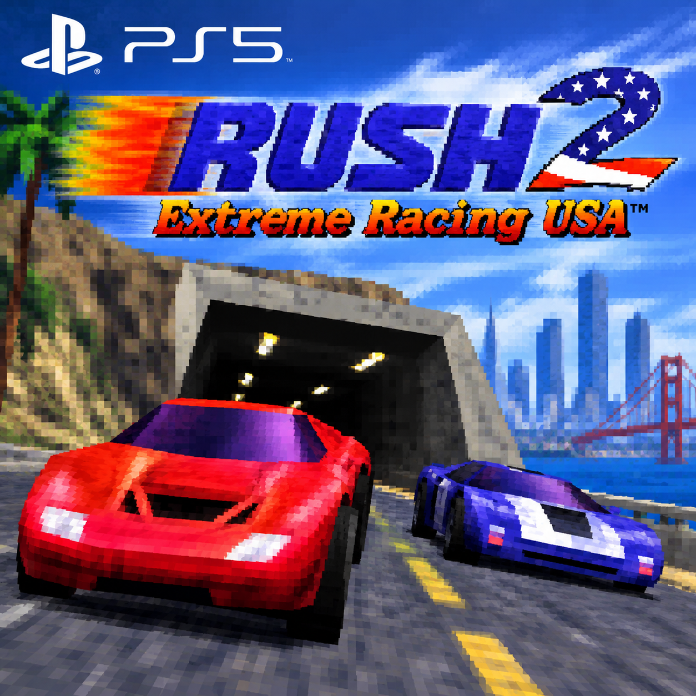

<p align="center"></p>

# Rush 2 Recompiled for the PlayStation 5

A port of [Rush 2 Recompiled](https://github.com/bryantmh/rush2recompiled) (v1.0.19) to native
PS5 homebrew. It runs as an installed title (`PPSA69423`) and renders with RT64 through Vulkan
on [Mihawk's RADV port](https://github.com/mihawk-99/PS5_Vulkan).

Published with the permission of bryantmh, the author of Rush 2 Recompiled.

## What works

Tested on one console (FW 13.60, ShadowMountPlus):

- The game, its menus and races, with sound and the DualSense
- Output at 3840x2160, rendered at the output resolution (`Auto`)
- 60 fps: RT64 interpolates the game's frames to the console's 60 Hz output

## Light bar

The DualSense light bar shows your car's MAIN COLOR: live while you choose it in the car select,
and in the race. Between races it keeps the last color. Each controller shows its own player's
car. Not tested on a console yet.

## The Rush 2 Recompiled menu

Rush 2 Recompiled adds its own menu over the game, with settings the N64 game does not have.

| | |
| --- | --- |
| Open or close | Click the touchpad. On a PC, Escape or the controller's Back button does this. The PS5 keeps the Create and PS buttons for itself, so they do not reach the game. |
| Change tab | L1 and R1 |
| Move | D-pad or left stick |
| Select | Cross |
| Back | Square |
| Apply changes | Triangle or Options |

The tabs, from left to right:

| Tab | What it has |
| --- | --- |
| General | Gameplay fixes and extras (car stats, torque, stunts, catch-up, pause menu, circuit, ghosts) and system options |
| Graphics | Resolution, frame rate, display, quality, effects and texture options |
| Sound | Volume and music |
| Controls | Button bindings and rumble |
| Progress | Unlocks and collectibles |
| Games | San Francisco Rush and Rush 2049: their ROMs and what they add (see below), and the battle settings |
| Cheats | The game's cheats |
| Mods | Installed mods |

Each option shows its description in the menu.

Differences on the PS5:

- There is no Data Location option. Settings, saves and mods are always in the title folder.
- There are no Select ROM buttons in the Games tab, because the PS5 has no file dialog. Put the
  ROMs in the title folder (see [SF Rush and Rush 2049](#sf-rush-and-rush-2049-optional)).
- There is no Open Dump Folder button in the Graphics tab. The `asset_dump` folder is in the
  title folder; reach it over FTP. Custom upscaler commands cannot run on the console.
- The mods folder is reached over FTP: `mods/` in the title folder.

## You need your own ROM

Neither this repository nor its builds contain the game. You need your own Rush 2: Extreme
Racing USA ROM, to play and to build.

### Rush 2 (required)

| | |
| --- | --- |
| Version | **Rush 2: Extreme Racing USA, USA release.** Other releases are refused ("incorrect version"). |
| File name | Any name. |
| Extension | `.z64`, `.n64` or `.v64`, in **lower case**. `ROM.Z64` is not found. |
| Byte order | Any: big-endian (`.z64`), byte-swapped (`.v64`) or little-endian. The game converts it. |
| Check | SHA-1 of the big-endian image: `01b0a31b1accc18061e8c85f6c5edf0dbd79f097`. A byte-swapped or little-endian file has a different SHA-1 and is still accepted. |
| Where | In the title folder, next to `eboot.bin`. Not in a subfolder. That is `/data/homebrew/PPSA69423/` when you copied the folder yourself, and `/mnt/ext1/etaHEN/games/PPSA69423/` when the Prospero Store installed it on the extended storage. |

On its first start the game imports the first valid ROM it finds there and keeps its own copy
as `rush2.n64.us.z64` in the same folder. After that the file you added can be removed. The
console has no file browser, so a ROM in another place is not found.

### SF Rush and Rush 2049 (optional)

Rush 2 Recompiled can add tracks and cars from San Francisco Rush and San Francisco Rush 2049.
On the PS5 they cannot be selected in the Games tab (there is no file dialog). Put the N64 ROMs
in the title folder instead. The same rules apply as for the Rush 2 ROM: any file name, the
extension `.z64`, `.n64` or `.v64` in lower case, any byte order.

| Game | SHA-1 of the big-endian image | Stored as |
| --- | --- | --- |
| San Francisco Rush: Extreme Racing (USA) | `cc62539cb30b180c3c7e0aa927786ed061d8d9ab` | `rush1.z64` |
| San Francisco Rush 2049 (USA) | `3f99351d7bb61656614bdb2aa1a90cfe55d1922c` | `rush2049.z64` |

On start the game looks for each ROM that it has not stored yet. It keeps a big-endian copy
under the name in the table, in the same folder. After that the file you added can be removed.
`rush2.log` records each import (`[PS5] Imported ...`). The Rush 2049 Dreamcast disc is not
found this way. Tested once on a console (FW 13.60): both ROMs were found and imported.

Other releases are refused, also SF Rush's "Rev A". The game reads its code and tracks at fixed
places in the ROM.

When a ROM is found, the Games tab shows "ROM found" (SF Rush) or "Using the N64 ROM"
(Rush 2049), and these options become available:

**San Francisco Rush**

| Option | What it does |
| --- | --- |
| SF Rush Tracks | Adds the seven race tracks of San Francisco Rush to the track select, after Rush 2's and Rush 2049's tracks. |
| SF Rush Car Stripes | Adds a ninth STRIPE choice, SF RUSH, to the cars whose paint in SF Rush had a pattern Rush 2 lacks: the Camaro's and Hot Rod's flames, the Taxi's checker band and the VW Bus's swirls. |

**Rush 2049**

| Option | What it does |
| --- | --- |
| Wings | Adds the wings from Rush 2049. Hold the Wings button while airborne to spread them, then steer in the air with the stick. Set the button in the game's Controller Setup screen. |
| Rush 2049 Tracks | Adds the six race tracks of Rush 2049 to the track select, after Rush 2's own tracks. |
| Rush 2049 Cars | Adds the thirteen cars of Rush 2049 to the car select, for players and computer cars, and Rush 2049's extra paint colors for every car. Takes effect the next time the car select opens. |
| Rush 2049 Computer Cars | Where the computer cars drive Rush 2049 cars: All Tracks, Rush 2049 Tracks (only there; Rush 2 cars elsewhere) or Off. Needs Rush 2049 Cars. |
| Car Speeds | Rush 2 tunes every car to Rush 2's speeds. Rush 2049 tunes them all to Rush 2049's, which accelerate harder but top out lower, and the speedometer reads like Rush 2049's (20% over true speed). Takes effect at the next race. |
| Odometer | Shows Rush 2049's odometer with each player's map: the miles the car has driven this race, on rolling digits (kilometers with the speedometer in km/h). |
| Rush 2049 Source | Which copy to use when both the N64 ROM and the Dreamcast disc are stored. On the PS5 only the N64 ROM can be added. |

The SF Rush and Rush 2049 options have not been tested on a console yet.

## Installing

1. Extract `Rush2Recompiled-PS5-<version>.zip`.
2. Copy the `PPSA69423` folder to `/data/homebrew/` on the console (for example over FTP).
3. Put your Rush 2 ROM in that folder (see [You need your own ROM](#you-need-your-own-rom)).
4. Let ShadowMountPlus register the title, then start Rush 2 Recompiled from the home screen.

Settings, saves and caches live in the title folder. `rush2.log` there records errors and
crashes.

## Building

You need Linux or WSL with Docker, Python 3 and git. Everything else is built in the container
(`docker/Dockerfile`: Ubuntu 26.04 with LLVM 18 and 21). SDL2, FreeType and their libraries
come from the PacBrew ports (v0.40.2), which `build.sh` downloads into `.deps/` on its first run
(`tools/setup-pacbrew.sh`, about 346 MB, checked by sha256). Set `PACBREW` to use another sysroot.

```sh
docker build -t rush2-ps5-build docker            # once
tools/setup-source.sh "Rush 2 - Extreme Racing USA (USA).n64"
./build.sh radv                                    # once: RADV, SDK fork, title converter
./build.sh configure
./build.sh
tools/package.sh                                   # dist/PPSA69423 with your ROM, for testing
tools/upload.sh                                    # to PS5_HOST over FTP, into PS5_DIR (/data/homebrew)
tools/package.sh --release                         # dist/Rush2Recompiled-PS5-<version>.zip, no ROM
```

`tools/setup-source.sh` clones Rush 2 Recompiled at the pinned commit with its submodules,
applies upstream's own `lib/patches` and then this port's `patches/`, clones Mihawk's
repositories at the commits ProsperoEden pins, and generates the game's code from the ROM.
After changing the sources in `src-upstream/`, `tools/make-patches.sh` writes `patches/` again.

The home screen icon `sce_sys/icon0.png` is made from `assets/icon.png`. The backgrounds
(`pic0.dds`, `pic1.dds`, 8 MB each) are not in the repository; make them from
`assets/background.png` with `tools/make-backgrounds.py assets/background.png sce_sys`
(needs Pillow and etcpak).

## How the port works

| Part | What it does |
| --- | --- |
| `cmake/ps5-toolchain.cmake` | Cross-compiles with Mihawk's payload SDK fork and PacBrew; host tools run on the host |
| `ps5/link-title.sh` | Links the title with the static RADV driver and the SDK's platform layer, then converts and signs it |
| `ps5/ps5_platform.cpp` | Buffered log in the title folder, crash reports, SDL's offscreen video driver, hides the splash screen |
| `ps5/ps5_paths.c` | Resolves relative paths against the title folder: a title has no working directory |
| `ps5/ps5-shims.c`, `ps5/nfd_stub.c` | C library functions the SDK lacks; file dialogs that always cancel |
| `patches/plume.patch` | Presents through `VK_KHR_display` on the console's display plane |
| `patches/N64ModernRuntime.patch` | N64 memory from a kernel reservation at 0x300000000 backed by direct memory |
| `patches/rt64.patch` | Host tools in a cross build, PS5 branches, ubershader pipelines compiled without temporary threads |
| `patches/RecompFrontend.patch`, `patches/rush2recompiled.patch` | PS5 branches: paths in the title folder, window, framerate default |

## Licences and credits

- This port's own files (`ps5/`, `patches/`, `cmake/`, `docker/`, `tools/`, the build scripts)
  are GPL-3.0-or-later (`LICENSE`).
- Rush 2 Recompiled by bryantmh: no licence published.
- N64Recomp, N64ModernRuntime, RecompFrontend and RT64: see their repositories.
- Mesa/RADV PS5 port, PS5_Vulkan and the payload SDK fork by Mihawk-99 (GPL-3.0 for PS5_Vulkan).
- Rush 2: Extreme Racing USA is © Midway. This port is not affiliated with or endorsed by
  Midway, Warner Bros., the Rush 2 Recompiled authors or Sony.
